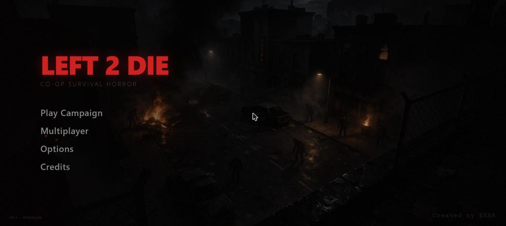

<h1 align="center">Hi, I'm Stefan Ristić 👋</h1>

  <b>Medior Software Engineer · Game Developer · Full-Stack Web Developer</b> 
  Unity &nbsp;·&nbsp; Blender &nbsp;·&nbsp; After Effects &nbsp;·&nbsp; HTML5 / TypeScript &nbsp;·&nbsp; Three.js &nbsp;·&nbsp; Pixi.js &nbsp;·&nbsp; Babylon.js

  📍 Belgrade, Serbia &nbsp;·&nbsp; 🌍 Open to remote, full-time roles

  
  
  

---

I work where **art meets engineering**. I build interactive experiences that look good, feel good and stay fast on mobile.

- 🌐 **Production web.** I've shipped 40+ client websites with custom PHP CMS/admin panels, freelance and with Apis Development, since 2021.
- 🎬 **Playable and ad creatives.** I was a Junior Creative Producer at **Replai**, working on creative production for mobile games with Unity, Blender, After Effects and DaVinci Resolve.
- 🧊 **Real-time 3D on the web.** I build Three.js product configurators with custom shader patches, instancing and quality tiers for mobile, plus Babylon.js and Pixi.js games.
- 🎮 **Games.** I make Unity/C# games, from game-jam builds with custom editor tools to a released horror game on itch.io.
- 🤖 **AI-assisted workflow.** I use Claude Code and other agentic tools every day for prototyping, coding, testing and asset pipelines.

## 🛠️ Toolbox

   
   
  

**Also:** Shader Graph · URP · GLSL shader patching (Three.js `onBeforeCompile`) · Babylon.js · Pixi.js v8 · GSAP · Maya · Mixamo · DaVinci Resolve · Claude Code

---

## ⭐ Featured work

<table>
<tr>
<td width="50%" valign="top">

</td>
<td valign="top">

### [Tricom: Three.js 3D roof configurator](https://github.com/esardev/tricom-3d-configurator)
A real-time WebGL configurator in production on a client site. It has parametric buildings, GLSL material patches (`onBeforeCompile`), rain and snow FX, SSAO, a 4K photo mode, render-on-demand and **quality tiers for mobile**. A bill of materials is measured straight from the 3D model, and the site runs on a custom PHP CMS.

`Three.js` `GLSL` `JavaScript` `PHP 8.3` · **[▶ Live](https://tricom.rs/en/configurator.html)**

</td>
</tr>
<tr>
<td width="50%" valign="top">

</td>
<td valign="top">

### [Cannon Run: playable ad prototype](https://github.com/esardev/cannon-run-playable-ad)
A Unity 6 URP runner built in about 6 hours for a playable-ads assignment. It has cannon movement, triggers, power-up choices and path variety, and was recorded in 9:16 and cut into a **30 s vertical ad** in After Effects.

`Unity 6` `URP` `C#` `After Effects`

</td>
</tr>
<tr>
<td width="50%" valign="top">

</td>
<td valign="top">

### [Save the King: mobile ad creative](https://github.com/esardev/save-the-king-ad-creative)
A full ad pipeline: concept, a Mixamo rig with the animation polished in Maya, a Blender scene with a **rigid-body rock simulation**, then After Effects for the UI, tutorial hand, fail popup and **Play Now end card**.

`Blender` `Maya` `After Effects`

</td>
</tr>
<tr>
<td width="50%" valign="top">

</td>
<td valign="top">

### [Game UI tech-art test](https://github.com/esardev/game-ui-tech-art-test)
A *World of Warships* commander-guise selector rebuilt in vanilla HTML/CSS/JS for **desktop and mobile**, with data-driven state, cross-fades, keyboard controls and a UI/UX critique of *Age of Mythology*.

`HTML5` `CSS` `JavaScript` · **[▶ Live](https://esardev.in.rs/wargaming)**

</td>
</tr>
<tr>
<td width="50%" valign="top">

</td>
<td valign="top">

### [Left 2 Die: co-op survival horror (prototype)](https://esardev.in.rs/lef2die/)
An early browser prototype of a co-op zombie shooter with a main menu, campaign setup, a four-survivor squad HUD and GLB characters. It is built with **Babylon.js + TypeScript + Vite**.

`Babylon.js` `TypeScript` `WebGL` · **[▶ Play the prototype](https://esardev.in.rs/lef2die/)**

</td>
</tr>
<tr>
<td width="50%" valign="top">

</td>
<td valign="top">

### [Escape Capyland: released Unity horror game](https://esardev.itch.io/escape-capyland)
A survive-the-night office horror game (a FNaF fan game) that I designed, built and released for free on itch.io.

`Unity` `C#` · **[▶ itch.io](https://esardev.itch.io/escape-capyland)**

</td>
</tr>
</table>

### More projects

| Project | What it is | Stack |
|---|---|---|
| [Almost Midnight](https://github.com/esardev/almost-midnight) | Narrative texting game in a phone Messages UI with an LLM-driven character, pluggable Gemini/Claude providers and an offline fallback | React · TypeScript · Express |
| [Multiplayer Wordle](https://github.com/esardev/multiplayer-wordle) | Turn-based two-player Wordle rooms with invite links, server-side scoring and rematches · [live](https://esardev.in.rs/wordlegame) | React · Vite · PHP · MySQL |
| [Audio to Text](https://github.com/esardev/audio-to-text) | Audio transcription with OpenAI, ffmpeg chunking, AI summaries and PDF export | Next.js · TypeScript |

---

## 🌐 Client work (live)

Production websites I built, most of them with a custom CMS/admin panel. The code belongs to the clients, so here are the live sites:

[Tricom (3D configurator)](https://tricom.rs/konfigurator.html) ·
[Neotehnika](https://neotehnika.rs) ·
[Profi Lift](https://profilift.rs/) ·
[Polovni Viljuškari](https://www.polovniviljuskari.rs) ·
[Akord Music (ticketing)](https://www.akordmusic.rs/) ·
[Termo Simax](https://www.termosimax.co.rs) ·
[Al Per](https://al-per.co.rs) ·
[Start Arhitektura](https://www.startarhitektura.rs) ·
[Emarh](https://www.emarh.rs) ·
[Adaptiva](https://adaptiva.rs/) ·
[MetalX](https://www.metalx.rs) ·
[Tehno S](https://www.tehnos.co.rs) ·
[JT Lika](https://www.jtlika.com/) ·
[Gips Design](https://gipsdesign.rs) ·
[Berg Membership](https://bergmembership.com/)
&nbsp;… and 25+ more on **[esardev.in.rs](https://esardev.in.rs)**.

## 💼 Experience

| When | Role |
|---|---|
| **Jan 2025 – Aug 2025** | **Replai**, Junior Creative Producer & Junior Operations Manager. I worked on team projects in Unity, Blender, After Effects and DaVinci Resolve, and coordinated tasks between developers, designers and leadership with Git and Office 365. |
| **2021 – present** | **Apis Development / Freelance**, Full-Stack Web Developer. I built 10+ websites on my own and contributed to 30+ team projects: responsive sites, CMS/admin panels and database-driven back ends (PHP, SQL/MSSQL, React/TypeScript, Node.js). |
| **2019 – present** | **Independent**, Indie Game Developer & Web Developer. I make Unity/C# games and HTML5 projects, and ship websites for small businesses, handling everything from hosting to deployment. |

**Education:** Singidunum University, Software & Information Engineering (2023 – present) · University of Belgrade, Faculty of Mathematics, Computer Science & Informatics (2019 – 2023)

**Languages:** Serbian (native) · English (advanced) · German (beginner)

Thanks for stopping by! The quickest way to reach me is <a href="mailto:soc.business.s@gmail.com">email</a>.

